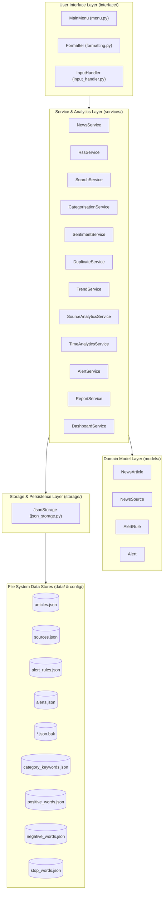
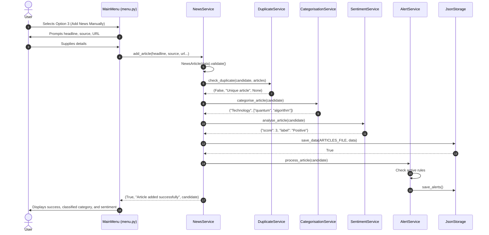

# System Architecture and Design Specification
## CO7095 – Software Measurement and Quality Assurance (2026–2027)
### News Monitoring and Analytics Application

---

## 1. Architectural Overview

The News Monitoring and Analytics Application follows a **Layered Domain-Driven Architecture** combined with the **Repository & Service Pattern**. The system strictly decouples the user presentation interface from the business analytics services, domain models, and physical persistence layer.

---

## 2. Layer Responsibilities

### 2.1 Presentation Layer (`interface/`)
- **`menu.py` (`MainMenu`)**: Coordinates user navigation loops, maps numbered choices to service calls, and catches unexpected runtime exceptions.
- **`formatting.py` (`Formatter`)**: Provides pure-Python ANSI/ASCII tabular formatting, column boundary truncation, colored status indicators (`[SUCCESS]`, `[ERROR]`, `[INFO]`), and header banners without requiring third-party libraries like `tabulate` or `curses`.
- **`input_handler.py` (`InputHandler`)**: Intercepts user inputs, provides defaults, performs type casting (`int`, `str`), validates choices, and safely handles `KeyboardInterrupt` and `EOFError` without crashing the program.

### 2.2 Service & Analytics Layer (`services/`)
- **`news_service.py` (`NewsService`)**: Central facade coordinating article CRUD, calling `CategorisationService` and `SentimentService` during intake, screening duplicates via `DuplicateService`, and routing new articles to `AlertService`.
- **`rss_service.py` (`RssService`)**: Handles XML feed downloads using `urllib.request` and parsing via `xml.etree.ElementTree`. Implements fault isolation for network timeouts, malformed tags, and missing channel elements.
- **`search_service.py` (`SearchService`)**: Implements multi-field filtering over memory collections using case-insensitive substring evaluation and date range boundaries.
- **`categorisation_service.py` (`CategorisationService`)**: Rule-based keyword matching dictionary loaded from `config/category_keywords.json`.
- **`sentiment_service.py` (`SentimentService`)**: Lexical polarity scoring using positive and negative lexicons with deterministic scoring: $\text{Score} = \text{Positive Matches} - \text{Negative Matches}$.
- **`duplicate_service.py` (`DuplicateService`)**: Multi-tier duplicate detector: exact URL, normalised URL, normalised headline, token fingerprint, and Jaccard token similarity ($\theta \ge 0.70$).
- **`trend_service.py` (`TrendService`)**: Extracts term frequency distributions excluding `config/stop_words.json`, tracking topic velocity across temporal slices.
- **`source_analytics_service.py` (`SourceAnalyticsService`)**: Computes source distributions, category proportions, and sentiment profiles per source.
- **`time_analytics_service.py` (`TimeAnalyticsService`)**: Buckets articles into daily, weekly (ISO calendar), and monthly groupings.
- **`alert_service.py` (`AlertService`)**: Manages keyword monitoring rules, prevents duplicate alerts for the same article/rule pair, and updates alert acknowledgment states.
- **`report_service.py` (`ReportService`)**: Generates structured CSV tabular reports in `reports/generated/` adhering to RFC 4180.
- **`dashboard_service.py` (`DashboardService`)**: Aggregates instantaneous telemetry for terminal rendering.

### 2.3 Model Layer (`models/`)
- **`article.py` (`NewsArticle`)**: Primary entity representing an ingested news record, holding identifiers, headline, body, metadata, category, sentiment score, keywords, and publication timestamps.
- **`news_source.py` (`NewsSource`)**: Entity representing registered RSS feeds and ingestion history.
- **`alert_rule.py` (`AlertRule`)**: Value object defining keyword criteria and optional category constraints.
- **`alert.py` (`Alert`)**: Notification entity logging triggered keyword detections.

### 2.4 Storage Layer (`storage/`)
- **`json_storage.py` (`JsonStorage`)**: Encapsulates atomic writes (writing to `.tmp` file, flushing to disk, and calling `os.replace`), generating automatic `.bak` backups before modifying existing records, and providing automatic failover when primary files are corrupted.

---

## 3. Class and Sequence Interaction

### Ingestion Sequence: Manual Article Addition & Alert Triggering

---

## 4. Architectural Design Principles

1. **Single Responsibility Principle (SRP)**: Each service owns a strictly delimited domain concern (e.g., `SentimentService` has zero file I/O responsibilities; `JsonStorage` has zero knowledge of article business logic).
2. **Open/Closed Principle (OCP)**: Adding new categories or sentiment terms requires editing external JSON dictionaries in `config/` rather than modifying core Python service code.
3. **Dependency Injection**: Services accept configurable dependencies (file paths, sub-services) in `__init__`, enabling mock testing and isolated in-memory unit testing.
4. **Resilience & Fault Isolation**: External dependencies (RSS network requests, XML parsing, disk file corruption) are guarded by specific exception handlers, ensuring the CLI interface remains responsive under failure modes.
