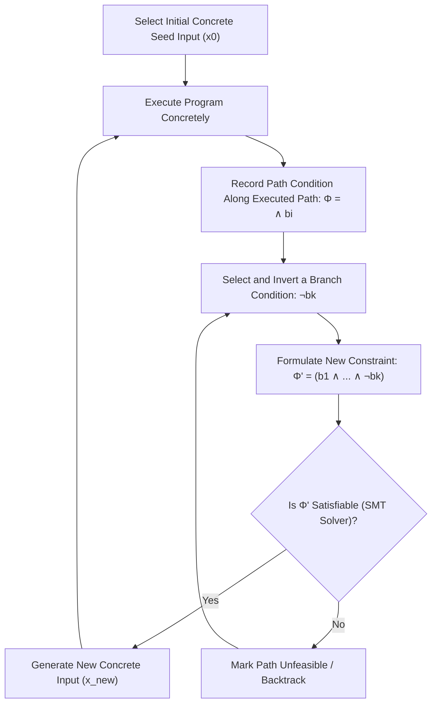

# Academic Research Study: Concolic Testing Analysis
## CO7095 – Software Measurement and Quality Assurance (2026–2027)
### News Monitoring and Analytics Application

---

## 1. Foundations of Concolic Testing

**Concolic Testing** (a portmanteau of **CONCrete** and symb**OLIC** execution), pioneered by Sen, Marinov, and Agha in systems like DART and CUTE (Sen et al., 2005), overcomes the limitations of pure symbolic execution by executing software simultaneously on **concrete inputs** while maintaining a parallel **symbolic representation** of memory state and path conditions.



### 1.1 Concolic Algorithm Workflow
1. **Concrete Seed Run**: Execute the target function with an initial concrete seed input ($x_0$).
2. **Symbolic Path Recording**: During concrete execution, monitor conditional branches traversed and accumulate the conjunction of boolean constraints:
   $$\Phi = b_1 \wedge b_2 \wedge \dots \wedge b_m$$
3. **Branch Condition Inversion**: Select a branch decision $b_k$ along the path and invert it ($\neg b_k$).
4. **Constraint Solving**: Construct a prefix path condition with the inverted branch:
   $$\Phi' = b_1 \wedge b_2 \wedge \dots \wedge b_{k-1} \wedge \neg b_k$$
5. **New Input Generation**: Submit $\Phi'$ to an SMT solver. If satisfiable ($\text{SAT}$), extract the satisfying assignment as a new concrete input ($x_{i+1}$).
6. **Iterative Path Exploration**: Re-execute concretely with $x_{i+1}$, discover new branches, and repeat until all reachable paths are explored.

---

## 2. Concolic Case Studies Applied to Project Functions

To demonstrate practical concolic execution across team responsibilities, four core application functions were subjected to concolic exploration:

---

### 2.1 Case Study 1: RSS XML Tag Ingestion (`RssService.parse_rss_xml`)
- **Author**: Nikitha Sarpur (`ns713`)
- **Target Function**: `RssService.parse_rss_xml(xml_content, default_source_name)`

#### Iteration 1 (Concrete Seed):
- **Seed Input**:
  ```xml
  <rss version="2.0">
      <channel>
          <item>
              <title>Global Market Growth</title>
              <link>https://news.org/1</link>
              <pubDate>Mon, 05 Oct 2026 10:00:00 GMT</pubDate>
          </item>
      </channel>
  </rss>
  ```
- **Concrete Execution Result**: Returns `(True, [NewsArticle], "")` (1 article parsed successfully).
- **Symbolic Path Condition**:
  $$\Phi_1 \equiv (\text{ParseXML} = \text{Valid}) \wedge (\text{ItemsCount} > 0) \wedge (\text{TitleNode} \ne \text{None}) \wedge (\text{len}(\text{Headline}) > 0)$$

#### Iteration 2 (Branch Inversion: Empty Title):
- **Negated Condition**: Invert $(\text{len}(\text{Headline}) > 0) \implies (\text{Headline} = "")$.
- **Generated Input**:
  ```xml
  <rss version="2.0"><channel><item><title></title><link>https://news.org/1</link></item></channel></rss>
  ```
- **Concrete Execution Result**: Returns `(True, [], "")` (item is safely skipped; 0 articles parsed).
- **Path Divergence**: Branch `if not headline: continue` traversed.

#### Iteration 3 (Branch Inversion: XML Well-Formedness):
- **Negated Condition**: Invert $(\text{ParseXML} = \text{Valid}) \implies (\text{XML} = \text{Malformed})$.
- **Generated Input**: `<rss><channel><item><title>Unclosed Tag`
- **Concrete Execution Result**: Catches `ET.ParseError`, returns `(False, [], "Malformed XML: ...")`.
- **Path Divergence**: Exception handler branch successfully exercised.

*Automated Test Evidence*: Verified in `ns713/test/concolic/concolic_testing/test_concolic_rss_parsing.py`.

---

### 2.2 Case Study 2: Keyword Categorisation (`CategorisationService.categorise_text`)
- **Author**: Sashi Dommaraju (`Sd683`)
- **Target Function**: `CategorisationService.categorise_text(headline, description, content)`

#### Iteration 1 (Concrete Seed - Technology Path):
- **Seed Input**: `"New artificial intelligence software and algorithm released."`
- **Concrete Result**: Assigned `"Technology"`, matched keywords: `['algorithm']`.
- **Symbolic Path Condition**:
  $$\Phi_1 \equiv (\text{Count}_{\text{Tech}} > 0) \wedge (\text{Count}_{\text{Tech}} \ge \max_{C \ne \text{Tech}} \text{Count}_C)$$

#### Iteration 2 (Branch Inversion: Negate Technology, Activate Business):
- **Negated Condition**: $(\text{Count}_{\text{Tech}} = 0) \wedge (\text{Count}_{\text{Business}} > 0)$.
- **Generated Input**: `"Stock market and investment revenue increased this quarter."`
- **Concrete Result**: Assigned `"Business"`, matched keywords: `['market', 'investment', 'revenue']`.
- **Path Divergence**: Business category resolution branch executed.

#### Iteration 3 (Branch Inversion: Negate All Categories):
- **Negated Condition**: $\forall C \in \text{Categories}, \text{Count}_C = 0$.
- **Generated Input**: `"The quiet stone bridge rested over the calm winding stream."`
- **Concrete Result**: Assigned `"Other"`, matched keywords: `[]`.
- **Path Divergence**: Fallback branch `if not scores: return DEFAULT_CATEGORY, []` executed.

*Automated Test Evidence*: Verified in `sd683/test/concolic/concolic_testing/test_concolic_categorisation.py`.

---

### 2.3 Case Study 3: Token Keyword Extraction (`TrendService.extract_keywords`)
- **Author**: Jyothi Bandalapati (`Jb1080`)
- **Target Function**: `TrendService.extract_keywords(text, min_length=3)`

#### Iteration 1 (Concrete Seed - All Valid):
- **Seed Input**: `"quantum processor algorithm"`
- **Concrete Result**: `['quantum', 'processor', 'algorithm']`
- **Symbolic Path Condition for each token $t$**:
  $$\Phi_1(t) \equiv (\text{len}(t) \ge 3) \wedge (\neg t.\text{isdigit}()) \wedge (t \notin \text{StopWords})$$

#### Iteration 2 (Branch Inversion: Short Length):
- **Negated Condition**: $\text{len}(t) < 3$.
- **Generated Input**: `"ai ox quantum"`
- **Concrete Result**: `['quantum']` (tokens "ai" and "ox" discarded).
- **Path Divergence**: Short token rejection branch verified.

#### Iteration 3 (Branch Inversion: Numeric Token):
- **Negated Condition**: $t.\text{isdigit}() = \text{True}$.
- **Generated Input**: `"quantum 2026 400 algorithm"`
- **Concrete Result**: `['quantum', 'algorithm']` (numbers "2026", "400" discarded).
- **Path Divergence**: Numeric token rejection branch verified.

*Automated Test Evidence*: Verified in `jb1080/test/concolic/concolic_testing/test_concolic_trend_extraction.py`.

---

### 2.4 Case Study 4: CSV Field Escaping (`ReportService.export_articles_csv`)
- **Author**: Jalakam Prashanth (`Pj161`)
- **Target Function**: `ReportService.export_articles_csv(articles, filename)`

#### Iteration 1 (Concrete Seed - Alphanumeric Only):
- **Seed Input**: `headline="Standard Clean Headline"`, `source="SimpleSource"`
- **Concrete Result**: Unquoted CSV row written.
- **Symbolic Path Condition**: No comma, quote, or newline in any field.

#### Iteration 2 (Branch Inversion: Embedded Commas):
- **Negated Condition**: $\text{Field contains } ','$.
- **Generated Input**: `headline="Breaking, Market, and Economy Report"`, `source="Global, Wire"`
- **Concrete Result**: RFC 4180 quotation wrapping applied: `"Breaking, Market, and Economy Report","Global, Wire"`.
- **Structural Integrity Check**: Parser reads exactly 8 columns without splitting row across commas.

#### Iteration 3 (Branch Inversion: Embedded Double Quotes):
- **Negated Condition**: $\text{Field contains } '"'$.
- **Generated Input**: `headline='Headline with "Quoted Phrase" Inside'`
- **Concrete Result**: Escaped double quotes: `"Headline with ""Quoted Phrase"" Inside"`.
- **Structural Integrity Check**: Re-read CSV returns identical literal quotation marks.

*Automated Test Evidence*: Verified in `pj161/test/concolic/concolic_testing/test_concolic_csv_export.py`.

---

## 3. Advantages of Concolic Testing over Pure Symbolic Execution

1. **Handling Native System Calls**: When an external library or operating system call is encountered (e.g., standard library `urllib` or file system timestamps), symbolic execution blocks because the solver cannot analyze C extensions or network sockets. Concolic testing solves this by substituting the **concrete execution return value** into the symbolic state and proceeding.
2. **Simplified Constraint Solving**: When complex non-linear arithmetic or obscure regular expressions appear, concolic testing replaces unconstrained terms with their concrete values, enabling the SMT solver to solve the remaining constraints easily.
3. **Guaranteed Reproducibility**: Every path explored in concolic testing was triggered by a genuine concrete execution, completely eliminating **false positive warnings** that often plague static analyzers.
