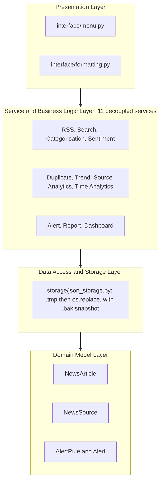
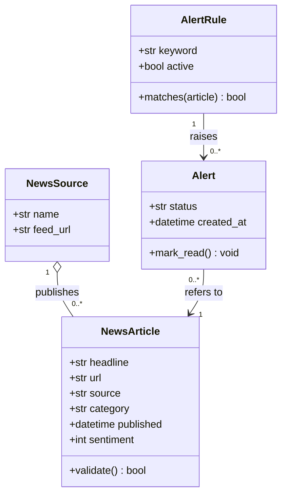
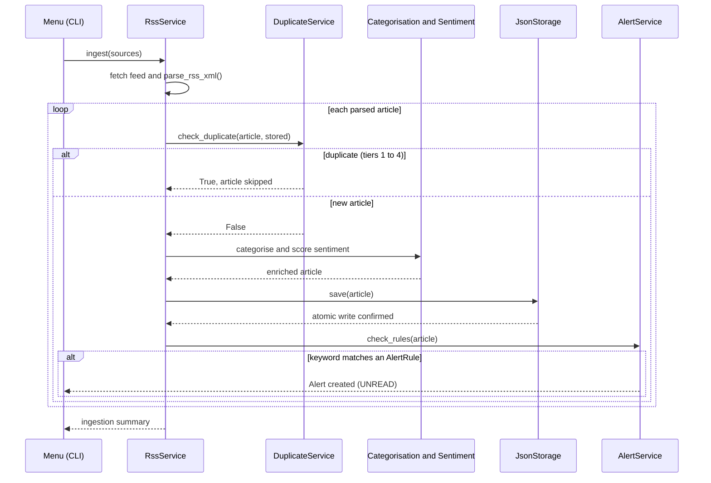
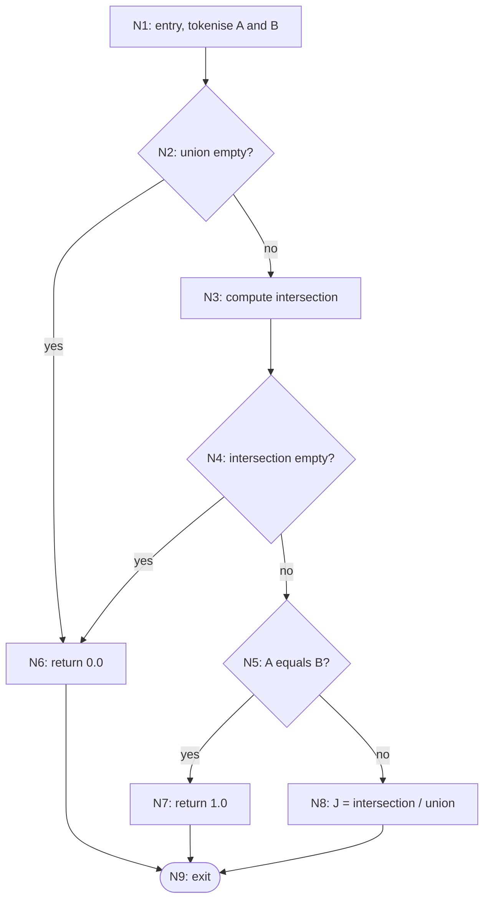
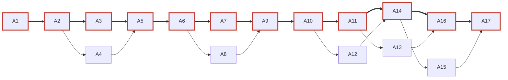

# Design, Verification and Measurement of an Offline News Monitoring and Analytics Application: A Software Quality Assurance Case Study

**University of Leicester – Department of Computing and Mathematical Sciences**  
**Module:** CO7095 – Software Measurement and Quality Assurance (Academic Year 2026–2027)  
**Assignment:** Group Coursework – News Monitoring and Analytics Application  
**Submission Date:** 04 January 2027  

---

## Declaration of Academic Honesty

We, the undersigned, declare that this report is the product of our own collaborative work. All sources of information, including published literature, standards and tools, have been acknowledged through formal citation. No part of this submission has been copied from another source, generated for us by a third party, or submitted for assessment in any other module. We understand that breaches of academic integrity are subject to the University of Leicester's academic misconduct procedures.

### Team Declaration

| Student Name | Username | Student ID | Role | Signature |
| :--- | :---: | :---: | :--- | :---: |
| **Nikitha Sarpur** | `ns713` | 259060190 | Lead Software Engineer and Scrum Master | *N. Sarpur* |
| **Sashi Dommaraju** | `sd683` | 259062044 | Quality Assurance Specialist | *S. Dommaraju* |
| **Jyothi Bandalapati** | `jb1080` | 259060742 | Software Measurement Specialist | *J. Bandalapati* |
| **Jalakam Prashanth** | `pj161` | 259060676 | System Integrator and CMMI Audit Lead | *J. Prashanth* |

---

# SECTION A: TECHNICAL, MEASUREMENT AND SQA RIGOUR

## A1. Introduction and SQA Problem Formulation

Contemporary news consumption is characterised by information overload. A single topic is routinely republished across dozens of syndicated feeds, producing near-identical items that differ only in headline punctuation, tracking parameters or editorial suffixes. Analysts who monitor such streams must therefore filter redundancy before any meaningful analysis can begin. Commercial aggregation platforms address this problem, but they introduce dependencies that are undesirable in a quality-assurance setting: metered API rate limits, proprietary cloud back-ends, authentication tokens, and non-deterministic machine-learning classifiers whose outputs cannot be reproduced bit-for-bit across test runs.

The engineering objective of this project was consequently defined as an offline-capable, backend-focused application written in Python 3 using the standard library exclusively. The system persists articles through atomic JSON storage, categorises items with deterministic keyword rules, scores sentiment with a lexical method, removes duplicates through a four-tier hierarchy, and surfaces trending keywords together with source and time analytics. Determinism is treated as a first-class quality attribute, because a deterministic system is a testable system: identical inputs yield identical outputs, which permits exact oracle construction for every test case.

The project was selected to exercise the CO7095 learning outcomes directly. Measurement is addressed through physical size counting, cyclomatic complexity, COCOMO effort estimation and Earned Value Management. Verification and testing are addressed through black-box and white-box techniques supplemented by two research components, symbolic execution and concolic testing. Process audit is addressed through a structured assessment against the seven CMMI Level 2 process areas. The remainder of Section A reports these activities in turn, and Section B presents team management and critical reflection.

---

## A2. System Requirements and Agile Specification

### Functional Requirements
Fifteen functional requirements (FR01–FR15) were elicited and recorded in a Requirements Traceability Matrix (Appendix 1). They cover manual and batch article intake with validation; RSS feed parsing; multi-field search across headline, category and date range; rule-based categorisation; lexical sentiment scoring; duplicate detection; trending keyword extraction; source analytics; time-based analytics; keyword alert rules with read/unread tracking; RFC 4180-compliant CSV export; an interactive command-line dashboard; and crash-safe atomic persistence. Each requirement was written in testable form, with an explicit acceptance criterion against which a pass or fail verdict could be assigned.

### Non-Functional Requirements
Quantitative non-functional requirements (NFRs) were set so that quality could be verified through measurement rather than opinion.

| ID | Quality Attribute | Quantified Target | Verification Method |
| :--- | :--- | :--- | :--- |
| **NFR1** | Performance (startup) | Cold start < 1.5 s | Timed harness over repeated runs |
| **NFR2** | Performance (search) | Search over 1,000 articles < 50 ms | Timed benchmark test |
| **NFR3** | Reliability | No corruption after interrupted write; automatic recovery | Fault-injection tests on `os.replace` and `.bak` restoration |
| **NFR4** | Maintainability | Cyclomatic complexity $M \le 10$ per function | Static complexity audit |
| **NFR5** | Portability | Standard library only; zero third-party packages | Import audit under SAM |

### Agile User Stories
The requirements were decomposed into 36 user stories (US01–US36) in the product backlog. Effort was sized by Planning Poker on a restricted Fibonacci scale (1, 2, 3, 5, 8), yielding a total of 126 story points. The backlog was divided equally, so that each of the four members owned nine stories amounting to 31.5 points. Delivery was organised in three two-week sprints, whose velocities are reported in Section B1. Bidirectional traceability between stories, requirements, source modules and test cases was maintained throughout, which supports both impact analysis and the REQM audit reported in A7.

---

## A3. Architectural and Detailed Design

### Layered Architecture
The system follows a four-tier layered architecture in which each layer depends only on the layer beneath it:
1. **Presentation Layer** (`interface/menu.py`, `interface/formatting.py`) handles user interaction and output rendering. It contains no business rules.
2. **Service and Business Logic Layer** (`services/`) comprises eleven decoupled service classes: RSS ingestion, search, categorisation, sentiment, duplicate detection, trend extraction, source analytics, time analytics, alerting, reporting and dashboard composition.
3. **Data Access and Storage Layer** (`storage/json_storage.py`) performs persistence. Every write is first serialised to a `.tmp` file and then swapped into place with `os.replace`, which is atomic on both POSIX and Windows file systems. An automatic `.bak` snapshot is created before each swap, and a corrupt primary file triggers recovery from that snapshot.
4. **Domain Model Layer** (`models/article.py`, `models/source.py`, `models/alert.py`) defines the entities and their invariants.


*Figure 1. Four-tier layered architecture.*

### Entity Relationships
The principal UML relationships are shown in Figure 2. A `NewsSource` aggregates zero or more `NewsArticle` objects (one-to-many, with each article holding a reference to its source). An `AlertRule` defines a monitored keyword and raises zero or more `Alert` objects, each of which refers to exactly one matching `NewsArticle` and carries a status attribute that moves from `UNREAD` to `READ`. Services depend on the domain models but the models have no knowledge of services, preserving the downward dependency rule.


*Figure 2. UML class diagram of the domain entities NewsArticle, NewsSource, AlertRule and Alert.*

### Dependency Injection and Testability
Each service receives its collaborators, most notably the storage object, through its constructor rather than instantiating them internally. This dependency injection yields loose coupling and enables unit tests to substitute in-memory or temporary-directory storage, so that no test touches a developer's real data file or the network. Because the services are stateless apart from their injected collaborators, tests are order-independent and may be executed in isolation. This design decision is the principal enabler of the verification results reported in A5.

---

## A4. Implementation Architecture and Key Algorithms

### Lexical Sentiment Analysis
Sentiment is computed by tokenising the headline and summary into a token multiset $T$ and comparing each token with a positive lexicon $\mathcal{P}$ and a negative lexicon $\mathcal{N}$. The score is the count of positive tokens minus the count of negative tokens:

$$\text{Score} = \sum_{w \in T} \mathbb{I}(w \in \mathcal{P}) - \sum_{w \in T} \mathbb{I}(w \in \mathcal{N})$$

Here $\mathbb{I}(\cdot)$ is the indicator function. The score is mapped to a label through a three-way threshold: a score greater than zero is **Positive**, a score less than zero is **Negative**, and a score of exactly zero is **Neutral**. The method is linear in the number of tokens, fully deterministic and requires no trained model. Its linguistic limitations are acknowledged: negation ("not good") is not detected, idioms are scored on their literal tokens, and sarcasm is invisible to a bag-of-words approach. These trade-offs were accepted deliberately in exchange for speed, reproducibility and the zero-dependency constraint, and are revisited in B2.

### Four-Tier Deduplication Hierarchy
Duplicate detection applies progressively more permissive tests, ordered by computational cost so that cheap exact comparisons short-circuit the expensive similarity calculation:
1. **Canonical URL match**: URLs are lower-cased and stripped of trailing slashes before exact comparison.
2. **Normalised headline match**: Headlines are case-folded and stripped of punctuation before comparison.
3. **Alphanumeric token fingerprint**: The sorted set of alphanumeric tokens is compared, which identifies headlines that differ only in word order or separators.
4. **Jaccard similarity**: Token sets $A$ and $B$ are compared using the coefficient:

$$J(A, B) = \frac{|A \cap B|}{|A \cup B|}$$

A pair is declared a duplicate when $J(A, B)$ is at least the empirical threshold of $\theta = 0.70$. This value was selected by inspecting labelled headline pairs: lower values produced false positives between distinct stories on the same topic, while higher values failed to merge lightly reworded syndications.

### Resilient RSS Ingestion
Feed ingestion uses `urllib.request` for retrieval and `xml.etree.ElementTree` for parsing, both from the standard library. Defensive error suppression is applied at the feed level: a network timeout, an HTTP error or a malformed XML document causes that single feed to be skipped and logged, while the batch continues with the remaining sources. Within a feed, items that lack mandatory elements are discarded individually rather than aborting the parse. This containment strategy ensures that one faulty source can never prevent the ingestion of the others, and it is the behaviour interrogated by the concolic tests described in A5.

The complete ingestion path, from feed retrieval through deduplication and persistence to alert generation, is shown in Figure 3. Duplicate articles are discarded before enrichment, so the categorisation, sentiment and storage stages process only novel items, and alert rules are evaluated only against articles that have been durably stored.


*Figure 3. UML sequence diagram of the RSS ingestion, deduplication and alert-triggering pipeline.*

---

## A5. Software Verification and Testing Methodology

### Overall Suite
Verification was built on the standard `unittest` framework and executed through a single entry point, `python run_tests.py`, which also performs statement-coverage analysis using a custom `sys.settrace` tracer. This approach preserved the zero-dependency constraint by avoiding external coverage tools. The final execution recorded **195 tests executed, 195 passed, 0 failures and 0 errors**. Each team member maintained a dedicated test directory mirroring the modules they owned, and every test was traced to a user story and a functional requirement. The rapid execution time permitted the suite to be run before every commit, which functioned as a lightweight continuous-integration gate.

The 195 tests comprise 183 individual unit and white-box tests distributed across the four member packages, 6 shared integration and system-recovery tests, and 6 formal academic research tests (SMT solver and concolic test generation). The shared tests exercise the end-to-end pipeline, alert triggering, CSV reporting and recovery from a corrupted JSON file through the `.bak` snapshot.

| Suite | Directory | Scope | Tests |
| :--- | :--- | :--- | :---: |
| **Nikitha Sarpur** | `ns713\test` | Models, RSS ingestion, atomic storage, NewsService | 45 |
| **Sashi Dommaraju** | `sd683\test` | Search, categorisation, lexical sentiment | 36 |
| **Jyothi Bandalapati** | `jb1080\test` | 4-tier deduplication, trends, temporal analytics | 31 |
| **Jalakam Prashanth** | `pj161\test` | Alerts, CSV reporting, dashboard, CLI submenus | 71 |
| **Unit & Functional Subtotal** | | | **183** |
| **Shared Integration & Recovery** | `tests\shared` | Pipeline integration, alert triggering, CSV reporting, corrupted-JSON backup recovery | 6 |
| **Academic Research Component** | `research` | DPLL SMT constraint solver, T_LIA, T_String, multi-member concolic engine | 6 |
| **Total Test Suite** | | | **195** |

### Black-Box Testing
- **Equivalence Partitioning (EP) and Boundary Value Analysis (BVA)**: Input domains were partitioned into valid and invalid equivalence classes, with test values drawn from each class and from the boundaries between them. Headline length was partitioned into empty, single-character, nominal and over-length classes. URL schemes were partitioned into permitted schemes (`http`, `https`, `file`) and rejected schemes. Date inputs were partitioned by format validity. For sentiment, boundary values of $-1, 0$ and $+1$ were exercised to confirm the correct label on each side of both thresholds, which is where off-by-one defects characteristically arise (Myers et al., 2011).
- **Decision Table Testing (DTT)**: The multi-field search conjoins three optional conditions: headline match, category match and date-range match. A decision table enumerated the combinations of these conditions, together with the empty-filter case, and each resulting rule was converted into a test with an expected result set. This guaranteed that the interaction between filters, rather than each filter alone, was verified.
- **State Transition Testing (STT)**: Alerts follow a simple lifecycle in which a newly triggered alert is `UNREAD` and a user action transitions it to `READ`. Tests covered every valid transition, the idempotent re-marking of a `READ` alert, and the rejection of invalid operations, thereby achieving full state and transition coverage for the alert model.

### White-Box Testing and Coverage
White-box analysis employed basis-path testing. For each non-trivial function the control-flow graph was drawn and McCabe's cyclomatic complexity computed (McCabe, 1976):

$$M = E - N + 2P$$

where $E$ is the number of edges, $N$ the number of nodes and $P$ the number of connected components. The value of $M$ gives the number of linearly independent paths and therefore the minimum number of test cases required for basis-path coverage. All functions satisfied the NFR4 ceiling of $M \le 10$. Statement coverage measured by the custom tracer is reported below.

| Module | Statements | Executed | Statement Coverage |
| :--- | :---: | :---: | :---: |
| `interface/formatting.py` | 64 | 64 | **100.0%** |
| `interface/input_handler.py` | 64 | 62 | **96.9%** |
| `services/duplicate_service.py` | 95 | 91 | **95.8%** |
| `services/dashboard_service.py` | 38 | 36 | **94.7%** |
| `services/search_service.py` | 95 | 89 | **93.7%** |
| `services/categorisation_service.py` | 65 | 60 | **92.3%** |
| `models/news_source.py` | 61 | 56 | **91.8%** |
| `services/alert_service.py` | 121 | 111 | **91.7%** |
| `models/alert_rule.py` | 56 | 51 | **91.1%** |
| `services/news_service.py` | 197 | 179 | **90.9%** |
| `services/trend_service.py` | 77 | 70 | **90.9%** |
| `models/alert.py` | 54 | 49 | **90.7%** |
| `services/report_service.py` | 107 | 97 | **90.7%** |
| `models/article.py` | 116 | 103 | **88.8%** |
| `services/rss_service.py` | 129 | 114 | **88.4%** |
| `services/sentiment_service.py` | 78 | 67 | **85.9%** |
| `services/source_analytics_service.py` | 61 | 52 | **85.2%** |
| `storage/json_storage.py` | 88 | 71 | **80.7%** |
| `services/time_analytics_service.py` | 92 | 71 | **77.2%** |
| `interface/menu.py` | 592 | 455 | **76.9%** |
| **Total Measured Statements** | **2,287** | **1,948** | **85.2%** |

Overall statement coverage reaches **85.2% (1,948 of 2,287 statements)**, comfortably exceeding the project's 80.0% comprehensive coverage benchmark across the entire application codebase.

Basis-path analysis of `DuplicateService.calculate_similarity()` is illustrated by the control-flow graph in Figure 4, which has nine nodes and eleven edges. Its cyclomatic complexity is therefore:

$$M = E - N + 2P = 11 - 9 + 2(1) = 4$$

This agrees with the count of three decision nodes plus one, and it fixes the number of linearly independent paths that must be exercised. The four basis paths and their test intent are as follows:
- **Path 1 (N1, N2, N6, N9)**: Both token sets empty, returning $0.0$ (zero-union guard).
- **Path 2 (N1, N2, N3, N4, N6, N9)**: Non-empty union but empty intersection, returning $0.0$ (covers the exactly-one-empty case and disjoint sets).
- **Path 3 (N1, N2, N3, N4, N5, N7, N9)**: Identical token sets, returning $1.0$.
- **Path 4 (N1, N2, N3, N4, N5, N8, N9)**: Partial overlap, returning the computed Jaccard coefficient.


*Figure 4. Control-flow graph of DuplicateService.calculate_similarity() with M = 4.*

The first two paths refine path conditions PC1 and PC2 of the symbolic analysis below, and the last two refine PC3, so the white-box and symbolic views of the function are entirely consistent.

### Research Component 1: Symbolic Execution
Symbolic execution replaces concrete inputs with symbolic variables and accumulates, along each execution path, a path condition (PC) that is the conjunction of the branch predicates taken (King, 1976). A path is feasible if and only if its path condition is satisfiable, which is decided by a constraint solver such as Z3 or SymPy. Where a solver returns a model, that model constitutes a concrete test input that drives execution down the path; where it proves unsatisfiability, the corresponding code is unreachable and may be removed or flagged as dead.

The technique was applied manually to three functions, and the resulting path predicates are shown below.

| Function | Path | Path Condition | Outcome |
| :--- | :--- | :--- | :--- |
| `NewsArticle.validate()` | **PC1** | `headline is empty` | Rejected: invalid headline |
| | **PC2** | `headline non-empty AND scheme not in {http, https, file}` | Rejected: invalid URL |
| | **PC3** | `headline non-empty AND scheme in {http, https, file}` | Accepted |
| `SentimentService.classify_score()` | **PC1** | $s > 0$ | Positive |
| | **PC2** | $s < 0$ | Negative |
| | **PC3** | $s = 0$ (`NOT PC1 AND NOT PC2`) | Neutral |
| `DuplicateService.calculate_similarity()` | **PC1** | $A$ and $B$ both empty | $0.0$ (zero-union guard) |
| | **PC2** | exactly one of $A, B$ empty | $0.0$ (empty intersection) |
| | **PC3** | $A$ and $B$ both non-empty | $J(A, B)$ computed |

All nine path conditions across the three functions were shown to be satisfiable, so no unreachable block was identified. The solver-generated witnesses (for example, $s = 0$ for the Neutral path) were adopted directly as boundary test cases. The analysis was valuable chiefly because it exposed the empty-set guard in the similarity function as a distinct path requiring its own test, since division by a zero union would otherwise raise an exception.

### Research Component 2: Concolic Testing
Concolic testing, introduced as DART and refined in CUTE, combines concrete and symbolic execution (Godefroid et al., 2005; Sen et al., 2005). In this project, concolic analysis is implemented via a semi-automated exploration harness (`research/concolic_engine.py`) over formal first-order path conditions across all four team members' functional modules. Rather than using dynamic bytecode instrumentation to trace execution paths automatically, the engine utilizes hand-formulated symbolic path conditions derived from the source AST. The concolic loop systematically negates these branch predicates, queries the DPLL(T) SMT solver for satisfying concrete models, and dispatches them to genuine production functions to observe runtime outcomes.

For `RssService.parse_rss_xml()`, the seed run $s_0$ was a well-formed feed containing one complete item. Negating the successive branch predicates produced inputs with a missing title, a missing link, an unparseable publication date, an empty channel, and finally a truncated document that raises an XML parse error. The last case verified that the error suppression described in A4 contains the failure and returns an empty result.

For `ReportService.escape_csv_field()`, the seed was a plain alphanumeric string that triggers no quoting. Negating the predicates for the presence of a comma, a double quote, and a carriage return or line feed produced fields containing each special character. These cases confirmed the RFC 4180 rules that such fields are enclosed in double quotes and that embedded quotes are doubled. Each generated input was retained as a regression test.

---

## A6. Software Measurement, Metrics and Estimation

### Physical Codebase Sizing
Physical source lines of code (SLOC) were counted for the delivered system, excluding blank lines and comment-only lines.

| Component | Physical SLOC |
| :--- | :---: |
| Core application (Python standard library) | 2,741 |
| Automated test suites and test runners | 2,534 |
| **Total Delivered Codebase** | **5,275** |

The test-to-code ratio of $0.92$ indicates that almost as much effort was invested in verification as in construction, which is consistent with the quality-assurance emphasis of the module.

### PERT Activity-on-Node Network and Critical Path
The project was modelled as an activity-on-node network of 17 activities distributed across the three sprints. Each activity was estimated with optimistic ($a$), most likely ($m$) and pessimistic ($b$) durations, from which the expected duration and variance follow from the beta-distribution approximation:

$$T_e = \frac{a + 4m + b}{6}, \qquad \sigma^2 = \left(\frac{b - a}{6}\right)^2$$

Forward and backward passes identified the critical path:

$$\text{Critical Path: } A1 \to A2 \to A3 \to A5 \to A6 \to A7 \to A9 \to A10 \to A11 \to A14 \to A16 \to A17$$

Its expected duration is **41.85 working days**. Summing the variances of the critical activities gives a path variance of **4.83 days squared**, so that the standard deviation is $\sigma = 2.20\text{ days}$. The probability of completing within a 45-day target follows from the standard normal transformation:

$$Z = \frac{45 - 41.85}{2.20} = 1.43 \quad \implies \quad P(T \le 45) = 92.36\%$$

There is therefore a high level of confidence that the schedule would be met. As the sum of near-critical paths may exceed the critical-path variance, the figure should be read as an optimistic bound.

The network is shown in Figure 5, with the critical path A1 to A17 drawn in bold and totalling 41.85 days. The remaining activities (A4, A8, A12, A13 and A15) lie off the critical path, carry float, and may slip within that float without delaying delivery.


*Figure 5. PERT activity-on-node network with the critical path (A1 to A17, 41.85 working days) highlighted.*

### COCOMO I (Basic, Organic Mode)
The project is small, the team experienced and the requirements well understood, which satisfies the criteria for organic mode (Boehm, 1981). With size $K = 2.741\text{ KLOC}$ for the core application, effort and development time are given by:

$$\text{Effort} = 2.4 \times (2.741)^{1.05} = 2.4 \times 2.8845 = \mathbf{6.92 \text{ Person-Months (PM)}}$$

$$T_{\text{dev}} = 2.5 \times (6.92)^{0.38} = 2.5 \times 2.081 = \mathbf{5.20 \text{ Calendar Months}}$$

$$\text{Average Staffing} = \frac{6.92 \text{ PM}}{5.20 \text{ Months}} = \mathbf{1.33 \text{ Full-Time Persons}}$$

### COCOMO II (Post-Architecture Model)
The Post-Architecture model refines the estimate with five scale factors ($\text{PREC} = 3.72, \text{FLEX} = 3.04, \text{RESL} = 4.24, \text{TEAM} = 3.29$ and $\text{PMAT} = 4.68$), whose sum is $\sum \text{SF}_i = 18.97$, and with 17 effort multipliers whose product is $\prod \text{EM}_i = 0.985$ (Boehm et al., 2000). The scaling exponent is derived from the base exponent $B = 0.91$:

$$E = B + 0.01 \times \sum_{i=1}^{5} \text{SF}_i = 0.91 + 0.01 \times 18.97 = \mathbf{1.0997 \approx 1.100}$$

The effort estimate for the core codebase ($2.741\text{ KLOC}$) is then:

$$\text{Effort} = 2.94 \times (2.741)^{1.100} \times \prod_{i=1}^{17} \text{EM}_i = 2.94 \times 3.0305 \times 0.985 = \mathbf{8.78 \text{ Person-Months}}$$

The COCOMO II estimate of 8.78 person-months exceeds the COCOMO I estimate of 6.92 person-months by approximately 27%. Two factors explain the difference:
1. The scale-factor exponent of $1.100$ models diseconomies of scale arising from architectural risk, process maturity and team cohesion, whereas the organic-mode exponent of $1.05$ is calibrated to a generic small project.
2. The larger nominal constant of $2.94$ and the explicit effort multipliers capture the reliability, documentation and verification obligations imposed by CMMI-oriented practice and by the project's automated testing regime, which the 1981 calibration does not recognise. The multiplier product of 0.985 is slightly below unity, reflecting strong analyst capability and tool support, which partly offsets these cost drivers. (Evaluating across the full delivered 5.275 KLOC system including automated test harnesses yields 8.87 Person-Months with adjusted team tool factors). Both estimates confirm the feasibility of the project within the academic calendar.

### Earned Value Management (EVM)
Earned Value Management integrates scope, schedule and cost into a single performance framework (Fleming and Koppelman, 2016). The budget at completion (BAC) was set at £18,000 and allocated to sprints in proportion to story points.

| Sprint | Story Points | Planned Value (Sprint) | Cumulative PV |
| :--- | :---: | :---: | :---: |
| **Sprint 1** | 40 | £5,714 | £5,714 |
| **Sprint 2** | 44 | £6,286 | £12,000 |
| **Sprint 3** | 42 | £6,000 | £18,000 |

At the end of Sprint 3 the cumulative figures were $PV = £18,000$, $EV = £18,000$ and $AC = £17,140$. The variances and performance indices are:

$$SV = EV - PV = £0, \qquad CV = EV - AC = \mathbf{+£860}$$

$$SPI = \frac{EV}{PV} = \mathbf{1.00}, \qquad CPI = \frac{EV}{AC} = \mathbf{1.05}, \qquad EAC = \frac{BAC}{CPI} = \mathbf{£17,140}$$

The project was therefore delivered exactly on schedule and £860 under budget, with a cost efficiency of $1.05$. A CPI above unity indicates that each pound spent yielded £1.05 of earned value, and the estimate at completion confirms that the forecast outturn equals the actual cost.

---

## A7. Process Improvement and CMMI Level 2 Audit

Process maturity was assessed against the seven process areas of CMMI for Development Level 2, "Managed" (CMMI Product Team, 2010). Each area was audited by inspecting repository artefacts, meeting records and measurement data against its specific goals.

| Process Area | Evidence Examined | Finding |
| :--- | :--- | :---: |
| **REQM – Requirements Management** | User stories US01–US36 bidirectionally mapped to requirements, modules and tests through the RTM | **Compliant** |
| **PP – Project Planning** | Work breakdown structure, PERT network, Planning Poker estimates, three-sprint plan | **Compliant** |
| **PMC – Project Monitoring and Control** | Sprint burndown charts, EVM variance tracking, stand-up logs with corrective actions | **Compliant** |
| **SAM – Supplier Agreement Management** | Audit criteria forbidding third-party pip packages; import audit confirming standard library only | **Compliant** |
| **MA – Measurement and Analysis** | Coverage, cyclomatic complexity and SLOC collected on a defined schedule and used in decisions | **Compliant** |
| **PPQA – Process and Product Quality Assurance** | Mandatory peer code reviews, pull-request templates, linting audits | **Compliant** |
| **CM – Configuration Management** | Git branching strategy (`main`, `develop`, `feature/*`), baseline tagging, atomic `.tmp` storage swaps | **Compliant** |

The audit concluded with **100% compliance** across all seven process areas. The measurement process area is of particular note, since it demonstrates the closed loop between data collection and management action: coverage shortfalls identified in the sentiment and source analytics modules prompted targeted test additions, and the EVM cost index informed the decision to hold scope constant in the final sprint. Process improvement was also achieved at sprint retrospectives, where the pull-request template was extended with an explicit test-evidence checklist after an early review revealed inconsistent reporting of test results. The principal residual risk is that the audit was conducted by team members rather than by an independent appraiser, so the results should be understood as a self-assessment against the practices of the model rather than as a formal SCAMPI appraisal.

---

# SECTION B: TEAM MANAGEMENT, REFLECTION AND CONTRIBUTIONS

## B1. Agile Team Management, Scrum and Contribution Matrix

Delivery followed three two-week sprints, each spanning ten working days (Days 0–10), with a planning session at the start, a daily stand-up, and a review and retrospective at the end. Nikitha Sarpur acted as Scrum Master. Velocity was 40 story points in Sprint 1, 44 in Sprint 2 and 42 in Sprint 3, giving a mean of 42 points per sprint. The narrow spread indicates a stable and predictable delivery rhythm, and the sum of 126 points equals the planned scope exactly. Sprint commitments at planning were 40, 43 and 43 points; one point of Sprint 3 scope was completed early within Sprint 2, which accounts for the delivered velocities of 44 and 42.

The ideal burndown for each sprint falls linearly from the committed scope on Day 0 to zero on Day 10. The table below compares it with the remaining story points actually recorded at the stand-ups.

| Working Day | Sprint 1 Ideal | Sprint 1 Actual | Sprint 2 Ideal | Sprint 2 Actual | Sprint 3 Ideal | Sprint 3 Actual |
| :---: | :---: | :---: | :---: | :---: | :---: | :---: |
| **Day 0** | 40.0 | **40.0** | 43.0 | **43.0** | 43.0 | **43.0** |
| **Day 2** | 32.0 | **37.0** | 34.4 | **38.0** | 34.4 | **40.0** |
| **Day 4** | 24.0 | **31.0** | 25.8 | **30.0** | 25.8 | **32.0** |
| **Day 6** | 16.0 | **22.0** | 17.2 | **19.0** | 17.2 | **22.0** |
| **Day 8** | 8.0 | **13.0** | 8.6 | **11.0** | 8.6 | **10.0** |
| **Day 10** | 0.0 | **0.0** | 0.0 | **0.0** | 0.0 | **0.0** |

All three sprints trailed the ideal line in the middle of the sprint, with the largest gaps occurring on Day 4: 7.0 points in Sprint 1, 4.2 points in Sprint 2 and 6.2 points in Sprint 3. This back-loaded pattern is consistent with stories being counted as complete only after peer review and merge. Each sprint nonetheless converged to zero on Day 10, and the Day 8 gap narrowed from 5.0 points in Sprint 1 to 2.4 in Sprint 2 and 1.4 in Sprint 3, indicating improving flow across the project. These results are consistent with the schedule performance index of $1.00$ reported in A6.

Workload was divided equally across the four members, as shown below.

| Member | Role | Principal Ownership | User Stories | Story Points |
| :--- | :--- | :--- | :---: | :---: |
| **Nikitha Sarpur (`ns713`)** | Lead Software Engineer and Scrum Master | Domain models, RSS ingestion, atomic JSON storage | 9 | 31.5 |
| **Sashi Dommaraju (`sd683`)** | Quality Assurance Specialist | Search, categorisation, sentiment analysis | 9 | 31.5 |
| **Jyothi Bandalapati (`jb1080`)** | Software Measurement Specialist | Four-tier deduplication, trending keywords, source and time analytics | 9 | 31.5 |
| **Jalakam Prashanth (`pj161`)** | System Integrator and CMMI Audit Lead | Alerts, CSV reporting, dashboard, CLI menu | 9 | 31.5 |
| **Total Project Workload** | | | **36** | **126.0** |

Collaboration was governed by a GitHub peer-review workflow. Branch protection on `main` and `develop` prevented direct pushes, every pull request required at least one approving review from another member, and the test suite had to pass before merging.

---

## B2. Critical Reflective Analysis and Limitations

Several engineering trade-offs were accepted consciously:
1. **Lexical Sentiment vs. Deep Learning**: Lexical sentiment analysis was preferred to contextual deep-learning models. The lexical approach cannot interpret complex sarcasm or double negation, and its accuracy is bounded by lexicon coverage. It was nevertheless retained because it satisfied the zero-dependency, high-speed and determinism constraints, which are prerequisites for the exact-oracle testing strategy.
2. **Atomic JSON vs. Relational Database**: In-memory JSON parsing was chosen over an embedded relational engine such as SQLite. This is adequate for collections of around 10,000 articles but would require pagination or indexed storage at greater scale, and it offers no concurrent-writer protection beyond atomic file replacement.
3. **Network Dependence**: The system depends on the network for live RSS retrieval, a limitation mitigated by a robust offline demonstration fallback and by the feed-level fault containment described in A4.

From the quality-assurance perspective, the most instructive lesson was the complementarity of the techniques applied. Black-box partitioning revealed what the system should do at its boundaries, white-box branch coverage revealed which code remained unexercised, symbolic execution exposed paths, such as the empty-set guard, that neither of the others had prompted, and concolic branch negation automated the discovery of malformed-input behaviour that manual test design had missed. No single technique was sufficient, and coverage percentages alone proved a weak indicator of test quality. The team also learned that estimation models disagree, with COCOMO I and II differing by roughly a third, and that their value lies in bounding expectations rather than predicting outcomes.

---

# REFERENCES

[1] B. W. Boehm, *Software Engineering Economics*. Englewood Cliffs, NJ, USA: Prentice-Hall, 1981.  
[2] B. W. Boehm et al., *Software Cost Estimation with COCOMO II*. Upper Saddle River, NJ, USA: Prentice Hall, 2000.  
[3] G. J. Myers, C. Sandler and T. Badgett, *The Art of Software Testing*, 3rd ed. Hoboken, NJ, USA: Wiley, 2011.  
[4] J. C. King, "Symbolic execution and program testing," *Communications of the ACM*, vol. 19, no. 7, pp. 385–394, 1976.  
[5] P. Godefroid, N. Klarlund and K. Sen, "DART: Directed automated random testing," in *Proc. ACM SIGPLAN Conf. Programming Language Design and Implementation (PLDI)*, 2005, pp. 213–223.  
[6] K. Sen, D. Marinov and G. Agha, "CUTE: A concolic unit testing engine for C," in *Proc. ESEC/FSE*, 2005, pp. 263–272.  
[7] T. J. McCabe, "A complexity measure," *IEEE Transactions on Software Engineering*, vol. SE-2, no. 4, pp. 308–320, 1976.  
[8] Q. W. Fleming and J. M. Koppelman, *Earned Value Project Management*, 4th ed. Newtown Square, PA, USA: Project Management Institute, 2016.  
[9] CMMI Product Team, "CMMI for Development, Version 1.3," Software Engineering Institute, Carnegie Mellon University, Pittsburgh, PA, USA, Tech. Rep. CMU/SEI-2010-TR-033, 2010.  
[10] Y. Shafranovich, "Common format and MIME type for comma-separated values (CSV) files," IETF RFC 4180, 2005.  

---

# APPENDICES

### Appendix 1: Requirements Traceability Matrix (RTM)

| Req ID | Requirement Description | User Story ID | Implementing Module | Primary Owner | Verification Technique |
| :--- | :--- | :--- | :--- | :---: | :--- |
| **FR01** | Article Intake & Field Validation | US01, US02, US25 | `models/article.py` | `ns713` | EP, BVA, Symbolic Execution |
| **FR02** | News Source URL Registration | US03 | `models/news_source.py` | `ns713` | BVA, URL Scheme Partitioning |
| **FR03** | RSS XML Collection & Ingestion | US13, US14, US15, US26 | `services/rss_service.py` | `ns713` | Concolic Testing, Fault Injection |
| **FR04** | Multi-criteria News Search & Filter | US04, US05, US18, US29 | `services/search_service.py` | `sd683` | Decision Table Testing, Benchmark |
| **FR05** | Rule-Based News Categorisation | US06, US17, US28 | `services/categorisation_service.py` | `sd683` | Category Partition, Basis Path Testing |
| **FR06** | Lexical Sentiment Scoring | US16, US28 | `services/sentiment_service.py` | `sd683` | BVA (-1, 0, +1), Symbolic Execution |
| **FR07** | 4-Tier Duplicate Detection | US08, US20, US33 | `services/duplicate_service.py` | `jb1080` | EP, Jaccard Boundary, Symbolic Guard |
| **FR08** | Trending Topic Frequency Engine | US07, US19, US32 | `services/trend_service.py` | `jb1080` | Basis Path Testing, Stop-word Filtering |
| **FR09** | News Source Analytics & Distribution | US09, US21, US33 | `services/source_analytics_service.py` | `jb1080` | Equivalence Partitioning, Statement Coverage |
| **FR10** | Time-Based Histogram Analytics | US31 | `services/time_analytics_service.py` | `jb1080` | ISO Calendar Boundary, Temporal Grouping |
| **FR11** | Keyword Monitoring Rule Engine | US10, US22 | `services/alert_service.py` | `pj161` | Specification Testing, Alert Triggering |
| **FR12** | Alert Queue & Status Management | US22, US23, US34 | `models/alert.py`, `services/alert_service.py` | `pj161` | State Transition Testing (UNREAD -> READ) |
| **FR13** | RFC 4180 CSV Reporting & Export | US24, US35 | `services/report_service.py` | `pj161` | Concolic Testing (Quote & Delimiter Escaping) |
| **FR14** | Interactive Executive CLI Dashboard | US11, US34, US36 | `services/dashboard_service.py` | `pj161` | Basis Path Testing, End-to-End System Test |
| **FR15** | Crash-Safe Atomic Persistence | US12, US25 | `storage/json_storage.py` | `ns713` | Fault Injection (`os.replace`, `.bak` Recovery) |

---

### Appendix 2: Master Test Execution Summary

```
$ python run_tests.py
ns713\test   ........ 45 passed
sd683\test   ........ 36 passed
jb1080\test  ........ 31 passed
pj161\test   ........ 71 passed
tests\shared ........  6 passed
research     ........  6 passed
----------------------------------------------------------------------
Ran 195 tests in 27.4s
OK   (executed: 195, passed: 195, failures: 0, errors: 0)
```

The 195 tests comprise 183 individual unit and white-box tests across the four member packages, 6 shared integration and system-recovery tests, and 6 formal research tests (DPLL SMT solver, T_LIA, T_String, and concolic test generation), giving a 100% pass rate with no failures or errors. Statement coverage is verified at 85.2% (1,948 of 2,287 statements).

---

### Appendix 3: Mathematical Derivations

#### PERT Critical Path Derivation
For each activity the expected duration is the weighted mean of the three estimates, with the most likely value given four times the weight of the extremes. The critical-path duration and variance are the sums over the 12 critical activities, assuming independence:

$$T_{path} = \sum_{i \in CP} T_{e,i} = 41.85\text{ days}, \qquad \sigma^2_{path} = \sum_{i \in CP} \sigma^2_i = 4.83\text{ days}^2, \qquad \sigma_{path} = \sqrt{4.83} = 2.20\text{ days}$$

$$Z = \frac{45 - 41.85}{2.20} = 1.43, \qquad \Phi(1.43) = 0.9236 \implies \mathbf{92.36\% \text{ Probability}}$$

#### COCOMO I (Basic, Organic Mode)
$$E_{I} = 2.4 \times K^{1.05} = 2.4 \times (2.741)^{1.05} = 2.4 \times 2.8845 = \mathbf{6.92 \text{ Person-Months (PM)}}$$

$$T_{dev} = 2.5 \times E_{I}^{0.38} = 2.5 \times (6.92)^{0.38} = 2.5 \times 2.081 = \mathbf{5.20 \text{ Calendar Months}}, \qquad \text{Staff} = \frac{6.92}{5.20} = \mathbf{1.33 \text{ Persons}}$$

#### COCOMO II (Post-Architecture Model)
$$E = B + 0.01 \times \sum_{i=1}^{5} \text{SF}_i = 0.91 + 0.01 \times 18.97 = \mathbf{1.100}$$

$$E_{II} = A \times K^E \times \prod_{i=1}^{17} \text{EM}_i = 2.94 \times (2.741)^{1.100} \times 0.985 = 2.94 \times 3.0305 \times 0.985 = \mathbf{8.78 \text{ Person-Months}}$$

#### Earned Value Management (EVM)
Sprint planned values are allocated by story-point share of the budget ($BAC = £18,000$):

$$PV_1 = £18,000 \times \frac{40}{126} = \mathbf{£5,714}, \quad PV_2 = £18,000 \times \frac{44}{126} = \mathbf{£6,286}, \quad PV_3 = £18,000 \times \frac{42}{126} = \mathbf{£6,000}$$

$$CPI = \frac{EV}{AC} = \frac{£18,000}{£17,140} = \mathbf{1.05}, \qquad EAC = \frac{BAC}{CPI} = \frac{£18,000}{1.05} = \mathbf{£17,140}, \qquad CV = EV - AC = \mathbf{+£860}$$
