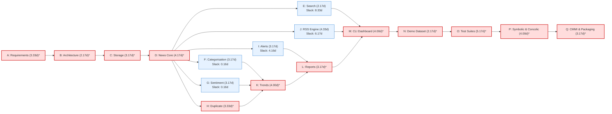

# Program Evaluation and Review Technique (PERT) & Critical Path Analysis
## CO7095 – Software Measurement and Quality Assurance (2026–2027)
### News Monitoring and Analytics Application

---

## 1. Introduction and Theoretical Background

The **Program Evaluation and Review Technique (PERT)** is a probabilistic project scheduling methodology designed to quantify schedule uncertainty and determine the project's **Critical Path**—the sequence of dependent activities that dictates the minimum total calendar duration required to complete the project.

### 1.1 PERT Mathematical Formulations

For each project activity, three duration estimates are gathered in working days:
- **Optimistic Duration ($O$)**: The minimum duration if execution proceeds flawlessly with zero impediments.
- **Most Likely Duration ($M$)**: The most realistic duration under normal working conditions.
- **Pessimistic Duration ($P$)**: The maximum duration assuming adverse events, technical complications, or impediments occur.

Under the assumption that activity durations follow a **Beta probability distribution**, the **Expected Duration ($T_E$)** and **Variance ($\sigma^2$)** are calculated as:

$$T_E = \frac{O + 4M + P}{6}$$

$$\sigma^2 = \left(\frac{P - O}{6}\right)^2$$

### 1.2 Network Passes and Float Analysis
- **Forward Pass (Earliest Times)**:
  - $\text{ES} = \max(\text{EF}_{\text{predecessors}})$
  - $\text{EF} = \text{ES} + T_E$
- **Backward Pass (Latest Times)**:
  - $\text{LF} = \min(\text{LS}_{\text{successors}})$
  - $\text{LS} = \text{LF} - T_E$
- **Total Float (Slack)**:
  - $\text{Slack} = \text{LS} - \text{ES} = \text{LF} - \text{EF}$
- **Critical Activity Condition**: An activity is on the critical path if and only if its total slack is exactly zero ($\text{Slack} = 0$).

---

## 2. Activity Dependency Table and PERT Calculations

The project is decomposed into 17 discrete engineering activities reflecting the actual development trajectory:

| ID | Activity Name | Predecessors | $O$ (days) | $M$ (days) | $P$ (days) | $T_E$ (days) | $\sigma^2$ (Variance) |
| :-: | :--- | :-: | :-: | :-: | :-: | :-: | :-: |
| **A** | Requirements Spec & User Stories (36 stories) | None | 2.0 | 3.0 | 6.0 | **3.33** | 0.44 |
| **B** | Architecture, Data Models, & Settings Design | A | 1.0 | 2.0 | 4.0 | **2.17** | 0.25 |
| **C** | Atomic Storage & Recovery Implementation | B | 2.0 | 3.0 | 5.0 | **3.17** | 0.25 |
| **D** | News Service & Source Management Backbone | C | 2.0 | 4.0 | 7.0 | **4.17** | 0.69 |
| **E** | Search & Multi-Filter Query Engine | D | 1.0 | 2.0 | 4.0 | **2.17** | 0.25 |
| **F** | Rule-Based Categorisation Service | D | 2.0 | 3.0 | 5.0 | **3.17** | 0.25 |
| **G** | Rule-Based Lexical Sentiment Engine | D | 2.0 | 3.0 | 5.0 | **3.17** | 0.25 |
| **H** | Duplicate Detection & Jaccard Engine | D | 2.0 | 3.0 | 6.0 | **3.33** | 0.44 |
| **I** | Keyword Monitoring & Alert Service | D | 2.0 | 3.0 | 5.0 | **3.17** | 0.25 |
| **J** | RSS Feed Ingestion & XML Parsing Engine | D | 3.0 | 4.0 | 7.0 | **4.33** | 0.44 |
| **K** | Topic Trending & Temporal Analytics | F, G, H | 2.0 | 4.0 | 6.0 | **4.00** | 0.44 |
| **L** | Reporting Engine & CSV Export Generation | I, K | 2.0 | 3.0 | 5.0 | **3.17** | 0.25 |
| **M** | Interactive CLI Dashboard & UI Menu | E, J, L | 2.0 | 4.0 | 6.0 | **4.00** | 0.44 |
| **N** | Offline Synthetic Demonstration Dataset | M | 1.0 | 2.0 | 4.0 | **2.17** | 0.25 |
| **O** | Master Test Suite (Black-box & White-box) | N | 3.0 | 5.0 | 8.0 | **5.17** | 0.69 |
| **P** | Symbolic & Concolic Research Analysis | O | 2.0 | 4.0 | 6.0 | **4.00** | 0.44 |
| **Q** | Measurement Analysis, CMMI Audit, Packaging | P | 2.0 | 3.0 | 5.0 | **3.17** | 0.25 |

---

## 3. Forward Pass, Backward Pass, and Slack Analysis

Using the calculated $T_E$ values, the forward and backward passes yield the following schedule schedule parameters:

| ID | Expected Duration ($T_E$) | Earliest Start (ES) | Earliest Finish (EF) | Latest Start (LS) | Latest Finish (LF) | Total Slack | Critical Status |
| :-: | :-: | :-: | :-: | :-: | :-: | :-: | :---: |
| **A** | 3.33 | 0.00 | 3.33 | 0.00 | 3.33 | **0.00** | **CRITICAL** |
| **B** | 2.17 | 3.33 | 5.50 | 3.33 | 5.50 | **0.00** | **CRITICAL** |
| **C** | 3.17 | 5.50 | 8.67 | 5.50 | 8.67 | **0.00** | **CRITICAL** |
| **D** | 4.17 | 8.67 | 12.84 | 8.67 | 12.84 | **0.00** | **CRITICAL** |
| **E** | 2.17 | 12.84 | 15.01 | 21.17 | 23.34 | **8.33** | Non-Critical |
| **F** | 3.17 | 12.84 | 16.01 | 13.00 | 16.17 | **0.16** | Non-Critical |
| **G** | 3.17 | 12.84 | 16.01 | 13.00 | 16.17 | **0.16** | Non-Critical |
| **H** | 3.33 | 12.84 | 16.17 | 12.84 | 16.17 | **0.00** | **CRITICAL** |
| **I** | 3.17 | 12.84 | 16.01 | 17.00 | 20.17 | **4.16** | Non-Critical |
| **J** | 4.33 | 12.84 | 17.17 | 19.01 | 23.34 | **6.17** | Non-Critical |
| **K** | 4.00 | 16.17 | 20.17 | 16.17 | 20.17 | **0.00** | **CRITICAL** |
| **L** | 3.17 | 20.17 | 23.34 | 20.17 | 23.34 | **0.00** | **CRITICAL** |
| **M** | 4.00 | 23.34 | 27.34 | 23.34 | 27.34 | **0.00** | **CRITICAL** |
| **N** | 2.17 | 27.34 | 29.51 | 27.34 | 29.51 | **0.00** | **CRITICAL** |
| **O** | 5.17 | 29.51 | 34.68 | 29.51 | 34.68 | **0.00** | **CRITICAL** |
| **P** | 4.00 | 34.68 | 38.68 | 34.68 | 38.68 | **0.00** | **CRITICAL** |
| **Q** | 3.17 | 38.68 | 41.85 | 38.68 | 41.85 | **0.00** | **CRITICAL** |

---

## 4. PERT Dependency Network Diagram

---

## 5. Critical Path and Schedule Risk Analysis

### 5.1 The Critical Path
The primary critical path through the dependency network is:
$$\mathbf{A \rightarrow B \rightarrow C \rightarrow D \rightarrow H \rightarrow K \rightarrow L \rightarrow M \rightarrow N \rightarrow O \rightarrow P \rightarrow Q}$$

- **Total Expected Project Duration ($T_{\text{project}}$)**:
  $$T_{\text{project}} = 3.33 + 2.17 + 3.17 + 4.17 + 3.33 + 4.00 + 3.17 + 4.00 + 2.17 + 5.17 + 4.00 + 3.17 = \mathbf{41.85 \text{ working days}}$$
  $$\approx 8.37 \text{ working weeks (or 5.98 calendar weeks under a 7-day academic schedule)}$$

### 5.2 Critical Path Variance and Standard Deviation
The total variance along the critical path is the sum of variances of its critical activities:
$$\sigma^2_{\text{critical}} = \sum_{i \in \text{Critical}} \sigma^2_i$$
$$\sigma^2_{\text{critical}} = 0.44 + 0.25 + 0.25 + 0.69 + 0.44 + 0.44 + 0.25 + 0.44 + 0.25 + 0.69 + 0.44 + 0.25 = \mathbf{4.83 \text{ days}^2}$$

$$\sigma_{\text{critical}} = \sqrt{4.83} \approx \mathbf{2.20 \text{ days}}$$

### 5.3 Probabilistic Completion Schedule
Using the standard normal variable $Z = \frac{T_{\text{target}} - T_E}{\sigma_{\text{critical}}}$:
- **Probability of completing within 42 days**:
  $$Z = \frac{42 - 41.85}{2.20} = +0.068 \implies P(T \le 42) \approx 52.7\%$$
- **Probability of completing within 45 days (9 weeks)**:
  $$Z = \frac{45 - 41.85}{2.20} = +1.432 \implies P(T \le 45) \approx \mathbf{92.4\%}$$

### 5.4 Schedule Risk Management Discussion
1. **Bottleneck Activities**: Activity **O** (Master Test Suite execution, 5.17d) and Activity **D** (News Service backbone, 4.17d) exhibit the highest individual variances ($\sigma^2 = 0.69$). Delays in these activities directly threaten the target deadline.
2. **Near-Critical Paths**: Activities **F** (Categorisation) and **G** (Sentiment) have a very narrow slack of only **0.16 days**. If either experiences even a minor 1-day delay, it instantly becomes critical and supplants Activity **H**.
3. **High Float Buffers**: Activity **E** (Search Engine, 8.33 days of slack) and Activity **J** (RSS Parsing, 6.17 days of slack) provide substantial scheduling flexibility, allowing team members assigned to them to assist on critical path activities if delays arise.
