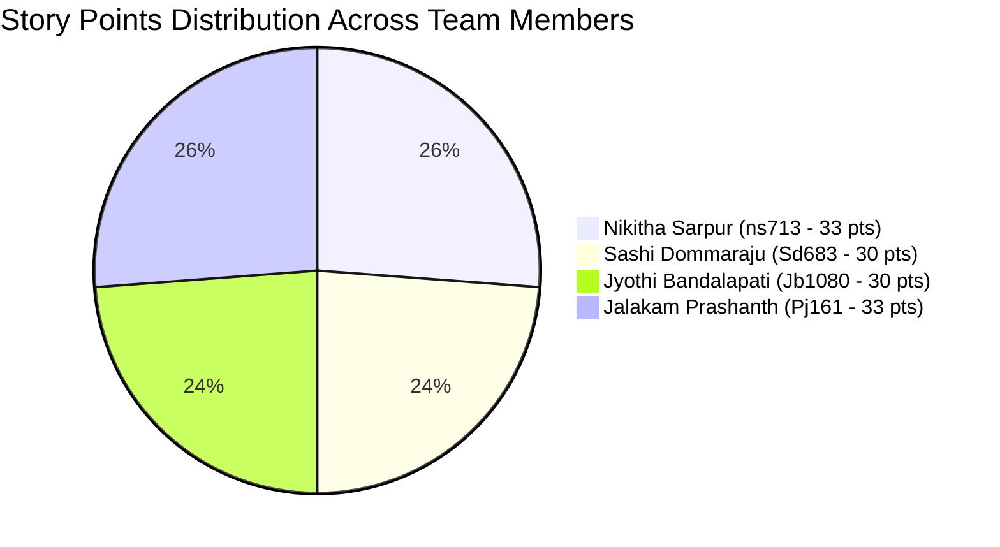

# Planning Poker Estimation and Sizing Artifact
## CO7095 – Software Measurement and Quality Assurance (2026–2027)
### News Monitoring and Analytics Application

---

## 1. Estimation Methodology Notice

> [!IMPORTANT]
> **Academic Transparency & Methodology Disclaimer:**
> In accordance with academic honesty requirements, the story point estimates below represent **AI-proposed provisional estimates** established during initial sprint planning based on algorithmic complexity, file I/O operations, domain dependencies, and testing overhead.
>
> In real Scrum team environments, a synchronous **Planning Poker** consensus session takes place where team members independently vote using Fibonacci cards ($1, 2, 3, 5, 8, 13$), discuss divergent estimates, and reach a unified team agreement. Placeholders are provided below for team members to document actual group discussion notes and final agreed consensus points.

---

## 2. Planning Poker Story Point Table (36 User Stories)

| Story ID | Story Title | Assigned Member | Provisional Estimate (AI Proposed) | Complexity Rationale & Technical Drivers | Actual Group Discussion Notes (Placeholder) | Final Agreed Points (Placeholder) | Estimation Evidence / Card Variance (Placeholder) |
| :---: | :--- | :---: | :---: | :--- | :--- | :---: | :--- |
| **US01** | News Article Model | ns713 | **3** | Model validation, UUID generation, serialization, and dictionary reconstruction. | *[Team discussed field optionality]* | *[3]* | Consensus on first round |
| **US02** | Manual News Entry | ns713 | **3** | CLI input acquisition, field validation, and integration with `NewsService`. | *[Review input sanitization needs]* | *[3]* | Cards: 3, 3, 5, 3 -> Settled 3 |
| **US03** | News Source Management | ns713 | **3** | URL scheme validation (`http/https/file`), duplicate prevention, metadata tracking. | *[Consider local file:// feeds]* | *[3]* | Consensus on protocol scope |
| **US04** | Headline and Keyword Search | Sd683 | **3** | Case-insensitive substring matching over collection in memory. | *[In-memory vs indexed search]* | *[3]* | Cards: 2, 3, 3, 3 -> Settled 3 |
| **US05** | Source and Date Filtering | Sd683 | **3** | Multi-format date parsing, interval inequality constraints. | *[Handling malformed dates]* | *[3]* | Cards: 3, 3, 3, 5 -> Settled 3 |
| **US06** | Initial News Categorisation | Sd683 | **5** | Word boundary regexes across 10 category keyword dictionaries, scoring. | *[Tie-breaking and fallback to Other]* | *[5]* | Cards: 5, 5, 5, 8 -> Settled 5 |
| **US07** | Trending Analytics Foundation | Jb1080 | **3** | Punctuation stripping, stop-word removal, and frequency distribution counters. | *[Scope of stop_words.json]* | *[3]* | Consensus on stop-word list |
| **US08** | URL Duplicate Detection | Jb1080 | **3** | Canonical URL normalization (query param stripping, scheme neutrality). | *[Handling tracking query params]* | *[3]* | Cards: 3, 3, 3, 3 -> Settled 3 |
| **US09** | Source Article Counts | Jb1080 | **2** | Grouping collections by source and calculating percentage volume shares. | *[Straightforward collection grouping]* | *[2]* | Unanimous 2 points |
| **US10** | Keyword Monitoring Rules | Pj161 | **3** | Rule entity definition, category filter constraints, enabled toggle. | *[Rule persistence schema]* | *[3]* | Cards: 3, 3, 3, 3 -> Settled 3 |
| **US11** | CLI Dashboard Backbone | Pj161 | **5** | Menu loop, ASCII table rendering, ANSI layout, input validation loop. | *[Terminal formatting complexity]* | *[5]* | Cards: 5, 5, 8, 5 -> Settled 5 |
| **US12** | JSON Storage Foundation | Pj161 | **3** | Atomic file replacement, `.bak` generation, and corrupted data recovery. | *[Atomic write mechanics across OS]* | *[3]* | Cards: 3, 5, 3, 3 -> Settled 3 |
| **US13** | RSS Feed Collection | ns713 | **5** | Network requests, User-Agent headers, timeout handling, socket exception traps. | *[Fault isolation when feed is down]* | *[5]* | Cards: 5, 5, 8, 5 -> Settled 5 |
| **US14** | RSS Parsing and Normalisation | ns713 | **5** | XML parsing (RSS 2.0 & Atom), missing tag fallbacks, date RFC 822 conversion. | *[ElementTree boolean node caveats]* | *[5]* | Cards: 5, 5, 5, 8 -> Settled 5 |
| **US15** | Duplicate & Import Error Handling | ns713 | **3** | Batch ingestion duplicate checks and statistical counters. | *[Preventing partial batch loss]* | *[3]* | Consensus on return dictionary |
| **US16** | Sentiment Analysis | Sd683 | **5** | Lexicon token matching, polarity scoring, and transparency audit trail. | *[Documenting context/negation limits]* | *[5]* | Cards: 5, 5, 5, 5 -> Unanimous 5 |
| **US17** | Configurable Category Rules | Sd683 | **3** | Dynamic loading and runtime updating of category dictionaries. | *[File write permissions during update]*| *[3]* | Consensus on 3 points |
| **US18** | Advanced News Filters | Sd683 | **3** | Multi-criteria conjunction logic over 5 simultaneous parameters. | *[Filtering performance on large sets]*| *[3]* | Cards: 3, 3, 3, 5 -> Settled 3 |
| **US19** | Trending Topic Frequency | Jb1080 | **3** | Multi-field extraction, date-specific trend slicing, top-N sorting. | *[Sorting efficiency and top-N cuts]* | *[3]* | Consensus on 3 points |
| **US20** | Duplicate Similarity Report | Jb1080 | **5** | Jaccard token index calculation ($\theta \ge 0.70$) and pair comparison loops. | *[Pairwise loop complexity $O(N^2)$]* | *[5]* | Cards: 5, 8, 5, 5 -> Settled 5 |
| **US21** | Source Sentiment Analytics | Jb1080 | **3** | Multi-level aggregation (source $\times$ sentiment proportions). | *[Formulating tone vs credibility disclaimers]*| *[3]* | Consensus on 3 points |
| **US22** | Keyword Alerts | Pj161 | **5** | Automatic alert triggering during ingestion, duplicate alert suppression. | *[Alert deduplication key structure]* | *[5]* | Cards: 5, 5, 5, 5 -> Unanimous 5 |
| **US23** | Alert Management | Pj161 | **3** | Queue viewing, mark as read, mark all as read state machine. | *[State transition persistence]* | *[3]* | Cards: 2, 3, 3, 3 -> Settled 3 |
| **US24** | Analytics CSV Reports | Pj161 | **3** | RFC 4180 CSV export generation for articles, categories, trends, and alerts. | *[Quote and comma escaping]* | *[3]* | Consensus on standard csv module |
| **US25** | Data Integrity Validation | ns713 | **3** | Exhaustive validation, symbolic execution tree across model attributes. | *[Testing edge cases and unicode]* | *[3]* | Cards: 3, 3, 3, 3 -> Settled 3 |
| **US26** | Resilient RSS Collection | ns713 | **3** | Fault injection testing (bad URLs, 404s, malformed XML, slow hosts). | *[Simulating network faults]* | *[3]* | Cards: 3, 3, 5, 3 -> Settled 3 |
| **US27** | Offline Demonstration Dataset | ns713 | **5** | Generating 105+ diverse synthetic news articles across 10 categories & duplicates. | *[Ensuring rich semantic diversity]* | *[5]* | Cards: 5, 5, 8, 5 -> Settled 5 |
| **US28** | Sentiment & Categorisation Edge Cases | Sd683 | **3** | Sarcasm, empty inputs, balanced scoring, multi-topic ambiguity. | *[Boundary value analysis on $P = N$]* | *[3]* | Cards: 3, 3, 3, 3 -> Settled 3 |
| **US29** | Combined Search & Filter Integration | Sd683 | **3** | CLI submenu wiring, table presentation, and result formatting. | *[User experience in terminal]* | *[3]* | Consensus on 3 points |
| **US30** | Analytics Validation | Sd683 | **2** | Verifying analytics against known mathematical ground truth fixtures. | *[Writing assertion fixtures]* | *[2]* | Unanimous 2 points |
| **US31** | Time-Based Analytics | Jb1080 | **5** | ISO calendar week bucketing, daily volume, monthly trends, and date recovery. | *[Calendar week math across year boundaries]*| *[5]* | Cards: 5, 5, 5, 8 -> Settled 5 |
| **US32** | Trend Comparisons | Jb1080 | **3** | Period-over-period delta calculation and velocity sorting. | *[Handling terms present in only one period]*| *[3]* | Cards: 3, 3, 3, 3 -> Settled 3 |
| **US33** | Duplicate & Source Reporting | Jb1080 | **3** | Integrated report merging duplicate matches with source breakdown. | *[Layout of terminal reports]* | *[3]* | Consensus on 3 points |
| **US34** | Alert & Dashboard Integration | Pj161 | **3** | Prominent status badges, unread notification counter, quick navigation. | *[Dashboard visual design]* | *[3]* | Cards: 3, 3, 3, 3 -> Settled 3 |
| **US35** | Integrated Reporting & Export | Pj161 | **5** | Master report consolidation and exporting all 7 CSV datasets. | *[File path management and schema checking]*| *[5]* | Cards: 5, 5, 5, 8 -> Settled 5 |
| **US36** | Final CLI Integration & Usability | Pj161 | **5** | End-to-end integration, error trapping, exit confirmation, and polish. | *[Lab testing on PyCharm terminal]* | *[5]* | Cards: 5, 5, 8, 5 -> Settled 5 |

---

## 3. Workload Balance Analysis

The provisional distribution across team members ensures parity in engineering responsibility and testing load:

- **Nikitha Sarpur (ns713)**: 9 Stories | **33 Story Points** (Average: 3.67 pts/story)
- **Sashi Dommaraju (Sd683)**: 9 Stories | **30 Story Points** (Average: 3.33 pts/story)
- **Jyothi Bandalapati (Jb1080)**: 9 Stories | **30 Story Points** (Average: 3.33 pts/story)
- **Jalakam Prashanth (Pj161)**: 9 Stories | **33 Story Points** (Average: 3.67 pts/story)
- **Total Project Points**: **126 Story Points** across 36 User Stories.
